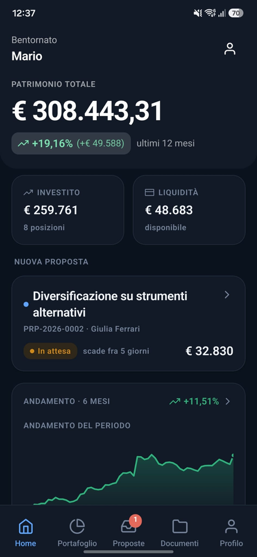
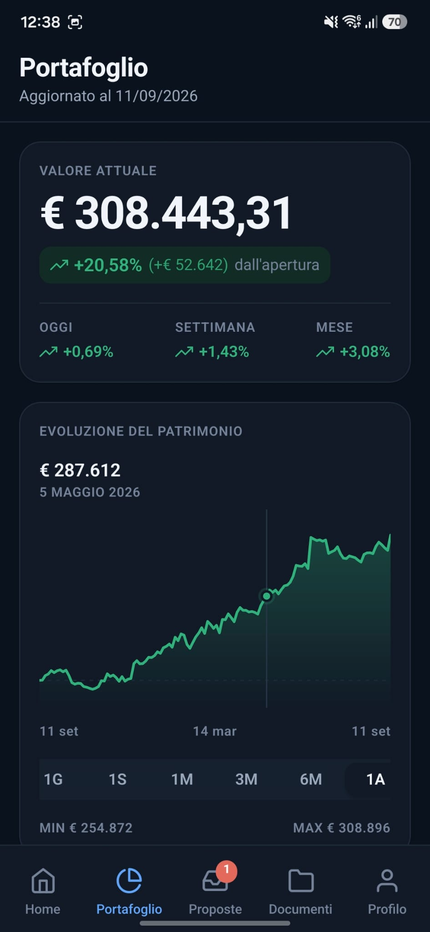
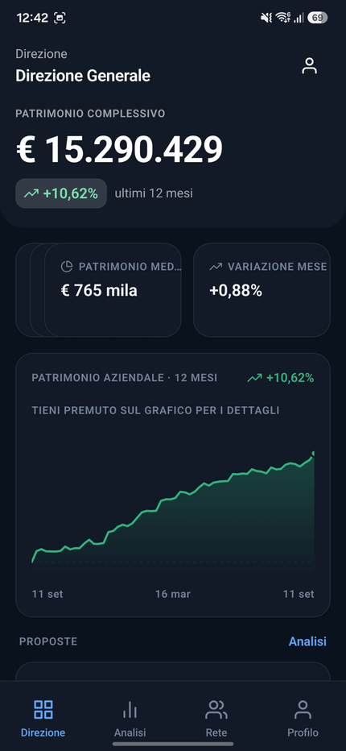

# SIMoney — Mobile Portfolio & Investment Management Prototype

📄 **[Project Presentation (PDF)](docs/SIMoney-presentation.pdf)**

A fully functional mobile application prototype for financial advisory, enabling clients to monitor their portfolio and manage investment proposals from a modern, lightweight interface — a concrete alternative to the browser-based platforms typically used in this sector.

This is not a mockup: it has a real REST backend, a database populated with two years of daily history, and a mobile app that communicates with it end-to-end.

[](https://expo.dev)
[](https://reactnative.dev)
[](https://www.typescriptlang.org)
[](https://fastify.dev)
[](https://www.prisma.io)
[](https://www.sqlite.org)

> [!IMPORTANT]
> **Demonstration project.** All data is **fictitious and generated by a deterministic seed**: invented names, `@demo.local` emails, fake ISINs, masked tax codes and IBANs.
> No real personal data, no connection to corporate systems or real intermediaries, no credentials in the repository. Accepting a proposal only simulates the user experience and is **not** a qualified electronic signature. Not production-ready, not published on any app store.

---

## Screenshots

| Client — Home | Client — Portfolio | Advisor — Dashboard | Management — Dashboard |
|:--:|:--:|:--:|:--:|
|  |  |  |  |

---

## Features

Three distinct areas with separate navigation and permissions, all behind the same login.

| Role | Capabilities |
|---|---|
| **Client** | Total portfolio value and variations · interactive chart across 7 time periods · point-in-time value by calendar date · asset allocation · holdings and position detail · transactions · proposals with accept/reject · PDF documents |
| **Advisor** | Dashboard (AUM, clients, expiring proposals) · client list with search, filters and sorting · client detail in tabbed view · **guided 6-step proposal creation** |
| **Management** | Aggregate portfolio and company KPIs · AUM time series · proposal funnel · advisor comparison · commercial network · activity audit log |

Role enforcement is server-side: a user cannot access or request data outside their perimeter, even by manipulating request IDs.

---

## Tech Stack

### Mobile (`/mobile`)

| Layer | Technology | Version |
|---|---|---|
| Framework | React Native | 0.86 |
| Toolchain | Expo SDK | 57 |
| Routing | expo-router (file-based) | 4 |
| Language | TypeScript | 6 |
| Data fetching | TanStack Query | 5 |
| Charts | react-native-svg (custom) | 15 |
| Animations | react-native-reanimated | 4 |
| Secure storage | expo-secure-store | — |
| PDF sharing | expo-file-system + expo-sharing | — |

### AI Tooling

| Tool | Role |
|---|---|
| [Claude Code](https://claude.ai/code) | AI coding assistant used throughout development (architecture, implementation, refactoring, documentation) |

### Backend (`/backend`)

| Layer | Technology | Version |
|---|---|---|
| Runtime | Node.js | ≥ 20.11 |
| Framework | Fastify | 5 |
| Language | TypeScript | 5.7 |
| ORM | Prisma | 6 |
| Database | SQLite (file-based, zero config) | — |
| Auth | JWT (access + refresh) · bcrypt | — |
| Security | Helmet · CORS · Rate limiting | — |
| Docs | Swagger UI (auto-generated) | — |

---

## Quick Start

**Prerequisites:** Node.js ≥ 20.11 and npm. No database installation required (SQLite on file).

Two terminals are needed.

```bash
# 1 — backend (demo data included)
cd backend
npm install
cp .env.example .env        # Windows: copy .env.example .env
npm run setup               # Prisma client + database + seed + demo PDFs
npm run dev                 # http://localhost:4000 · Swagger at /docs
```

```bash
# 2 — mobile app
cd mobile
npm install
npx expo start
```

Then install **Expo Go** on your phone and scan the QR code: the app auto-detects the computer's address running Metro (requires the same Wi-Fi network). Alternatively press `a` for the Android emulator or `i` for the iOS simulator.

If the backend is unreachable, from the login screen: ⚙️ → **Demo Server** → enter `http://<PC-IP>:4000` → *Verify connection*.

### Demo Credentials

Single password **`Demo1234!`** (the **"Use a demo account"** button on the login screen logs in with one tap).

| Role | Email | What it shows |
|---|---|---|
| Client | `mario.rossi@cliente.demo.local` | € 308,443 · 2-year history · 2 pending proposals |
| Advisor | `giulia.ferrari@consulente.demo.local` | 7 clients · ~€ 4.9M AUM · proposal creation |
| Management | `direzione@demo.local` | € 15.3M · 20 clients · 5 advisors · business analytics |

---

## Architecture

```
┌────────────────────────────────────────────────────────────────────┐
│  Mobile App  (React Native + Expo)                                  │
│                                                                     │
│  app/client/   app/advisor/   app/admin/                           │
│       ↓               ↓             ↓                               │
│  TanStack Query  ──  API client  ──  expo-secure-store (tokens)    │
└──────────────────────────┬─────────────────────────────────────────┘
                           │  REST / JSON   Bearer token
┌──────────────────────────▼─────────────────────────────────────────┐
│  Backend  (Fastify 5 + TypeScript)                                  │
│                                                                     │
│  modules/ (routes)  →  services/ (domain)  →  providers/ (data)   │
│                                                   │                 │
│                              ┌────────────────────┤                 │
│                              ▼                    ▼                 │
│                       MockDataProvider    GuardianDataProvider      │
│                       (Prisma + SQLite)   (future integration)      │
└────────────────────────────────────────────────────────────────────┘
```

The data source abstraction (`PortfolioDataProvider` interface in `src/providers/types.ts`) is the single swap point: switching to a production data source only requires implementing that interface. Routes, services, and the mobile app remain unchanged.

### Repository Structure

```
.
├── backend/            REST API (Fastify + Prisma + SQLite)
│   ├── prisma/         schema and deterministic demo data seed
│   └── src/
│       ├── modules/    routes per area (auth, client, advisor, admin, document, system)
│       ├── services/   domain logic and authorization checks
│       ├── providers/  data source abstraction (mock | guardian)
│       └── tests/      end-to-end API tests
├── mobile/             Expo / React Native app
│   ├── app/            expo-router routes, one folder per role
│   └── src/            API client, design system, charts, domain components
└── docs/               analysis, screenshots, presentation
```

---

## Automated Checks

```bash
cd backend && npm test                               # 76 end-to-end API tests
cd backend && npm run typecheck                      # backend type check
cd mobile  && npm run typecheck                      # app type check
cd mobile  && npm run bundle:check                   # Metro bundle compilation check
cd mobile  && node scripts/check-api-contract.mjs   # backend ↔ app contract verification
```

`check-api-contract.mjs` replays the same calls the screens make and verifies the fields actually read by the UI — it catches a backend change that would break the app without opening an emulator.

---

## Demo Data

5 advisors · 20 clients · **730 days of daily history** with per-asset-class composition · 6 configurable asset classes · 21 fictitious instruments · ~160 holdings · ~470 transactions · 53 proposals across all four states · ~73 generated PDF documents · total portfolio ~€ 15.3M.

The seed is **deterministic**: same `SEED_RANDOM_SEED`, same figures on every reinstall. Dimensions and seed are configured via `.env`; to regenerate everything:

```bash
cd backend && npm run setup
```

The database (`prisma/dev.db`) and generated PDFs (`storage/`) are **not versioned**: they are recreated by the command above.

---

## Security & Privacy

- No real personal data: invented names, `@demo.local` emails, masked tax codes and IBANs, fictitious ISINs.
- No secrets in the repository: only `.env.example` with placeholder values to replace (`JWT_ACCESS_SECRET`, `JWT_REFRESH_SECRET`, `DEMO_PASSWORD`).
- Passwords hashed with bcrypt, short-lived JWT access tokens plus revocable refresh tokens, Helmet, CORS and rate limiting configured server-side.
- Ownership checks in the service layer: IDs from the client are never trusted.
- Only session keys are stored on the device, in the OS encrypted storage. No financial data persisted locally.

---

## Documentation

| Document | Contents |
|---|---|
| [docs/00-ANALISI.md](docs/00-ANALISI.md) | Full analysis: requirements, architecture, tech choices and rationale, data model, roles, authorizations, flows |
| [docs/SIMoney-presentation.pdf](docs/SIMoney-presentation.pdf) | Project presentation (PDF) |
| [backend/README.md](backend/README.md) | Backend installation, configuration, startup and tests |
| [mobile/README.md](mobile/README.md) | App structure, product decisions, commands, build |
| `http://localhost:4000/docs` | Interactive Swagger UI (requires backend running) |

---

## Project Status

| Phase | Scope | Status |
|---|---|---|
| **0** | Analysis: requirements, architecture, technologies, data model, flows | ✅ Complete |
| **1** | Backend: REST API, authentication, roles, mock data, data source abstraction, tests | ✅ Complete |
| **2** | Mobile app: Android + iOS, three role-based areas, charts, proposals, documents | ✅ Complete |
| **3** | APK / TestFlight build and delivery | 📋 Documented, pending execution |

Known gaps before production use: integration with the production data source, qualified electronic signature, corporate SSO, push notifications, migration to PostgreSQL, final branding and icon.

---

## License

Demonstration project, portfolio purposes only. All rights reserved — no license granted for use, reproduction or distribution without explicit written agreement.
